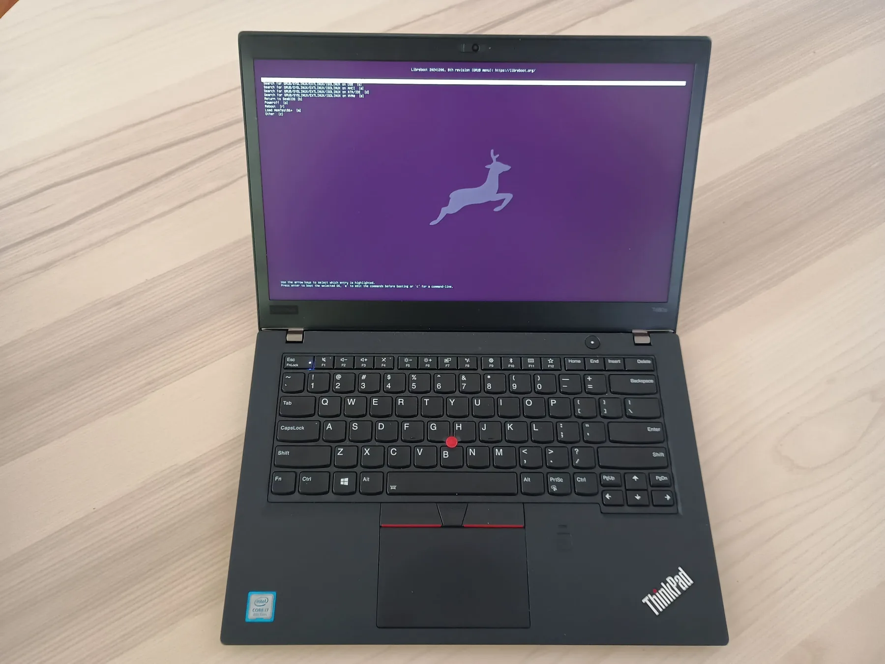

# Libreboot BIOS

Libreboot is free, open-source boot firmware for computers, built on coreboot, that replaces the laptop's proprietary BIOS or UEFI. This guide installs it on a Lenovo ThinkPad whose firmware sits on one SOIC-8 flash chip or two, using a Raspberry Pi Pico as an external programmer: build Libreboot and the Pico's firmware from source, clip the Pico onto the laptop's flash chip (each in turn, on a board with two), back up the original firmware, and write the new image. It takes three to five hours and about $15 to $30 of parts, and gives a [Bitcoin computer](/docs/advanced/bitcoin-computer/) or [air-gapped computer](/docs/learn/wallets/air-gapped-wallets/) firmware whose source you can read.

<GuideFacts />

## What does Libreboot change, and what doesn't it?

Libreboot replaces the vendor firmware that starts the computer with open-source code, and it reduces, but does not eliminate, Intel's proprietary code. Since 2022 it follows what it calls a binary blob reduction policy: a board gets the vendor code it cannot boot without, and nothing more.

| | Lenovo firmware | Libreboot |
|---|---|---|
| Firmware source | Closed | Open (coreboot, plus Libreboot's build system) |
| Intel Management Engine (ME) | Fully enabled | Cut down with me_cleaner and disabled; on the X220, T420 and newer it cannot be removed entirely |
| Intel Boot Guard (T480s) | Enforced: only Lenovo-signed firmware runs | Disabled with deguard |
| Other vendor code | Built in | Only what the board needs to boot, such as CPU microcode and memory set-up code on some models |
| Boot menu | Lenovo's | EDK2 (UEFI), with SeaBIOS and GRUB available |

The **Intel Management Engine** is a separate processor inside Intel chipsets, running its own closed firmware with access to memory and the network, that operates independently of the operating system. On the X220, the T420 and every newer ThinkPad the CPU will not run without part of its firmware, so Libreboot cannot remove it. It uses me_cleaner to strip the ME firmware to the minimum needed to start the machine and to switch it off after that. The ME is removed completely only on older boards such as the ThinkPad X200 and T400. No ThinkPad Libreboot supports uses an AMD processor, so AMD's equivalent (the PSP) does not arise.

What this buys a Bitcoin computer is firmware you can audit and rebuild yourself, a much smaller body of closed code running before your operating system, and no vendor update channel that could change it underneath you. It does not make the hardware free of all closed code, and Libreboot's own documentation says so.

## Which ThinkPads can this guide flash? {#which-laptops-does-this-guide-cover}

This guide flashes any ThinkPad that Libreboot builds firmware for and whose firmware sits on SOIC-8 chips, the 8-pin package the clip grips; [build ROMs](/docs/libreboot/roms/#step-1-find-your-laptops-target) lists every ThinkPad target as of Libreboot 26.10rev16 (4 November 2026). What changes the steps is whether the firmware is on one flash chip or two, and the size at the end of the target name tells you which:

| Flash | Target name ends in | For example | What you do differently |
|---|---|---|---|
| One chip | `_2mb`, `_4mb`, `_8mb` or `_16mb` | X220, T420, T480s, X280 | Back up and write the whole image in one go |
| Two chips, 8 MB and 4 MB | `_12mb` | X230, T430, T440p, T530, W530, W541 | Split the image in two, then back up and write each chip in turn |

A few models need something extra on top:

- The T480 and T480s need Lenovo's firmware updated first, and some need their Thunderbolt chip re-flashed; see [requirements](/docs/libreboot/requirements/).
- On some two-chip boards the chip you are not flashing interferes with the one you are, and needs its chip-select line held high; the T530 and W530 do, and Libreboot documents the same for the W541. See [connection](/docs/libreboot/raspberry-pico/connection/).
- Older one-chip boards such as the X200, T400 and T500 can have a SOIC-16 chip instead, and the X200S and X200 Tablet a WSON-8 one, which the SOIC-8 clip does not fit. Libreboot's [install page](https://libreboot.org/docs/install/) for each board says which.

## What changed in Libreboot 26.10?

Libreboot 26.10 "Ominous Olive", released on 15 October 2026, made EDK2, an open-source UEFI implementation, the default payload on most boards, with SeaBIOS and GRUB still available. Board targets now carry the vendor's name (`lenovo_thinkpad_t480s_16mb` rather than `t480s_16mb`), and image names start with `uefi_` or `bios_`. Revisions have followed up to 26.10rev16 on 4 November 2026: a build now comes out as a `.tar.xz` archive of images, and since 26.10rev12 SeaBIOS is only in the `bios_` images, no longer inside the UEFI one. The build and ROM pages of this guide follow 26.10rev16. If you are updating a machine flashed with an older release, see [update Libreboot](/docs/libreboot/update-bios/).

## What are the steps?

| Step | Page | What you do |
|---|---|---|
| 1 | [Requirements](/docs/libreboot/requirements/) | Get the laptop, a Raspberry Pi Pico H, a SOIC-8 clip and cables |
| 2 | [Build Libreboot](/docs/libreboot/build/) | Install dependencies and get the build system |
| 3 | [Build ROMs](/docs/libreboot/roms/) | Build the firmware image for your laptop, and split it if the board has two chips |
| 4 | [Build flashprog](/docs/libreboot/build-flashprog/) | Build the program that reads and writes the chip |
| 5 | [Build serprog](/docs/libreboot/raspberry-pico/build-serprog/) | Turn the Pico into an SPI programmer |
| 6 | [Connect the Pico](/docs/libreboot/raspberry-pico/connection/) | Wire the Pico to the clip and the clip to the chip |
| 7 | [Flash the BIOS](/docs/libreboot/flashing-bios/) | Back up the original firmware, then write Libreboot |

Help is available in the #libreboot channel on Libera IRC. If your laptop is not supported by Libreboot, the [coreboot guide](/docs/coreboot/) covers a route that supports more devices, at the cost of more vendor code.
