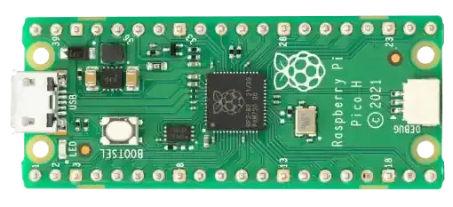
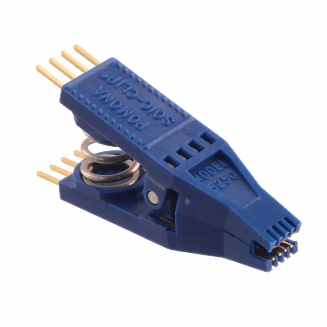

# Hardware requirements

Flashing Libreboot externally needs five things: a supported ThinkPad, a Raspberry Pi Pico H to act as the programmer, a Pomona 5250 SOIC-8 clip, short female-to-female jumper wires, and a micro USB cable that carries data. Together the flashing parts cost about $15 to $30. This guide is written for ThinkPads whose firmware sits on SOIC-8 (8-pin) chips.

## Which laptop?

Any ThinkPad Libreboot supports whose firmware sits on SOIC-8 chips. What matters for the rest of this guide is whether that firmware is on one flash chip or two, which the [Libreboot overview](/docs/libreboot/#which-laptops-does-this-guide-cover) explains how to tell from the target name. Two-chip boards that need the chip-select fix, such as the T530 and W530, also need a test hook, an AMS1117 3.3 V regulator and a 5 V adapter, listed on the [connection page](/docs/libreboot/raspberry-pico/connection/#what-extra-parts-do-you-need).

### What the T480s needs first

Libreboot's [T480 and T480s instructions](https://libreboot.org/docs/install/t480.html) add three requirements the older models do not have:

1. Update Lenovo's own UEFI and embedded controller firmware to the version Libreboot specifies before installing, and change the settings it lists (Thunderbolt BIOS Assist off, Secure Boot off, and others).
2. Remove both the internal battery and the CMOS coin cell before flashing; on the T480s the battery has to come out completely.
3. Deal with the Thunderbolt firmware chip. Early T480 and T480s firmware writes debug logs to the Thunderbolt controller's own flash chip until it fills, after which Thunderbolt and fast charging stop working. Libreboot documents an external re-flash of that chip, done before Libreboot itself and in a strict order; follow their page exactly if your machine needs it.

## Raspberry Pi Pico H

The Raspberry Pi Pico H is a Pico with its header pins already soldered on, and it is the programmer Libreboot recommends: it runs at 3.3 V logic, so it cannot damage these chips with 5 V signals, and it costs a few dollars. Use the original Pico (RP2040). Libreboot removed support for the Pico 2 because of stability problems, and the Pico W works but needs extra vendor firmware for its unused Wi-Fi chip.

## Pomona 5250 SOIC-8 clip

The Pomona 5250 is the clip that grips the 8-pin chip while it is still soldered to the board. Cheaper clips exist, but they slip, and a clip that loses contact mid-write is the most common way to end up with a corrupt chip.

## Female-to-female jumper wires, 10 cm

Short wires connect the Pico to the clip. Keep them to about 10 cm: longer wires pick up interference at SPI speeds and cause read and write errors.

## Micro USB cable that carries data

The cable connects the Pico to the computer running the flashing software. Many micro USB cables carry power only; if the Pico does not appear as a device when plugged in with BOOTSEL held, try another cable.

